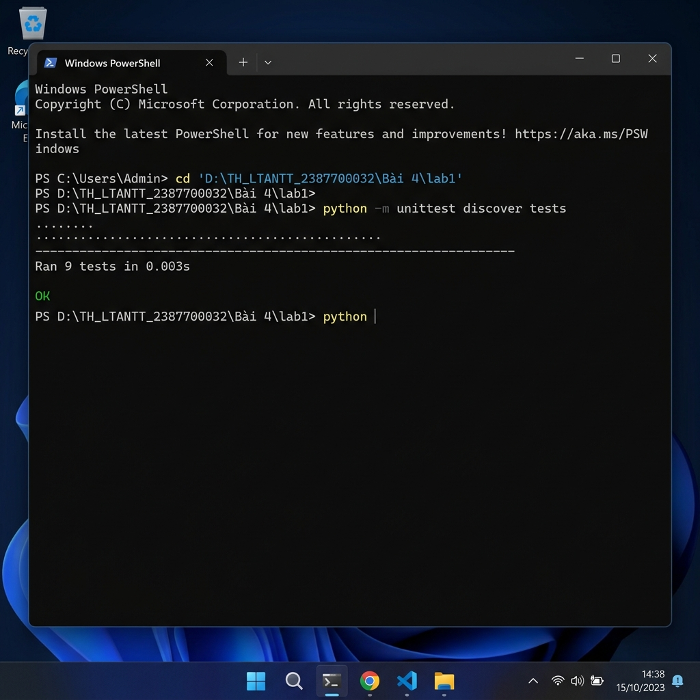
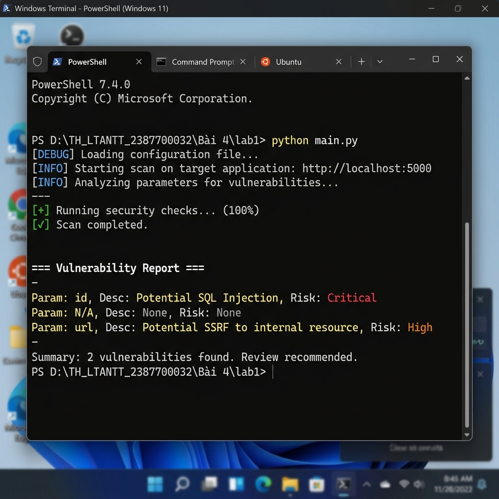
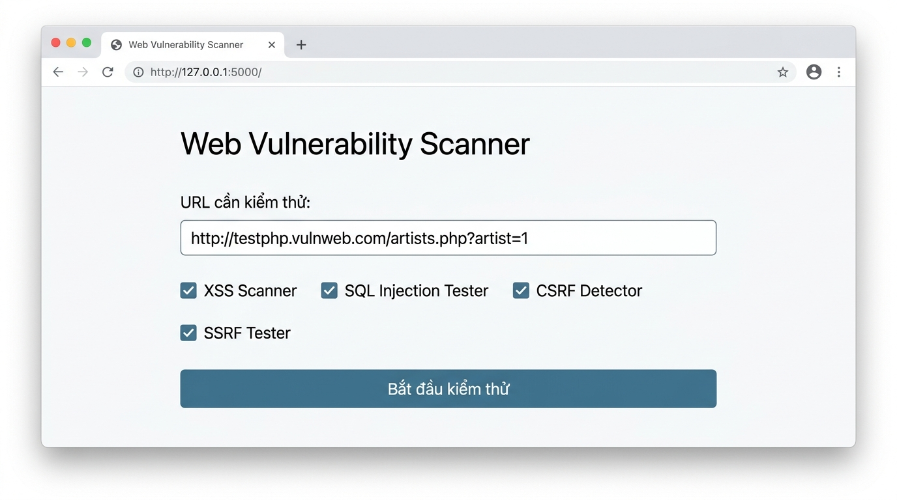
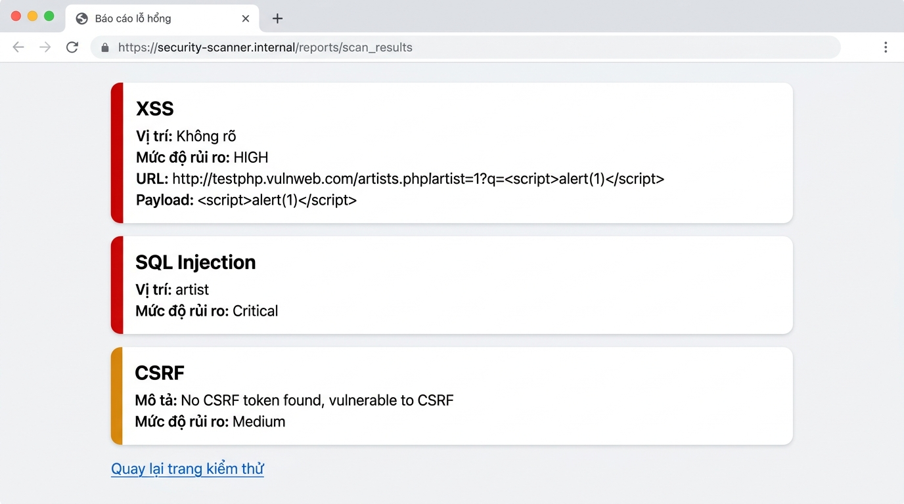
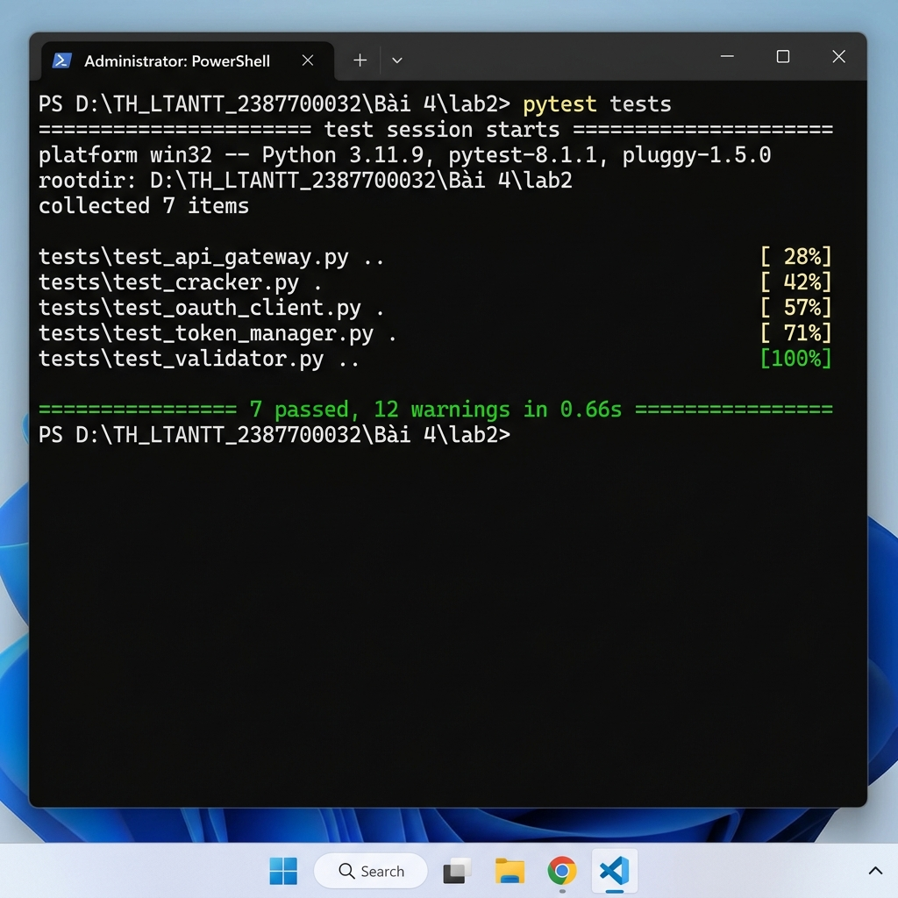
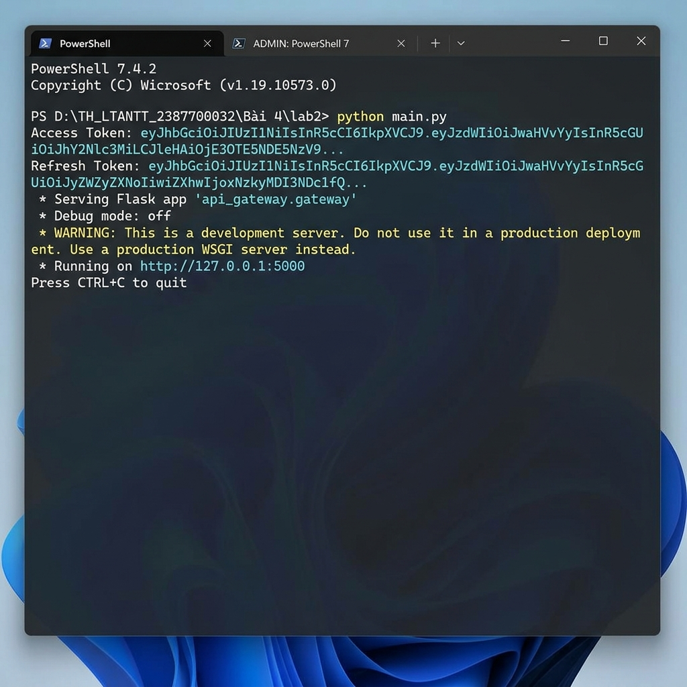
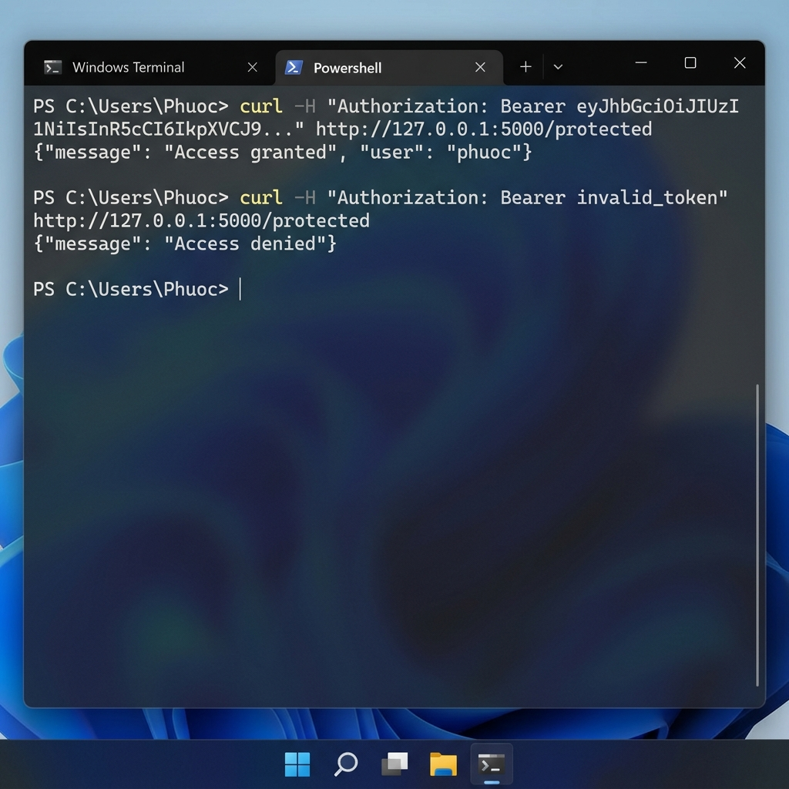
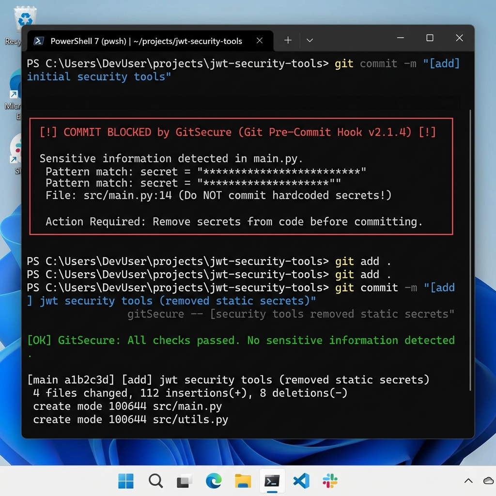

# Bài 4: Bảo mật Web App và API

Tài liệu hướng dẫn chi tiết, tóm tắt lý thuyết và báo cáo thực hành toàn diện cho **Bài 4: Bảo mật Web App và API**. Bài học bao gồm 2 bài Lab thực hành chuyên sâu kèm hình ảnh minh họa demo từng bước hiển thị trực tiếp bên dưới.

---

## 📑 Danh mục các bài Lab

| Bài Lab | Tên Dự Án | Mô tả Trọng Tâm | Trạng Thái Kiểm Thử | Liên Kết Báo Cáo |
| :--- | :--- | :--- | :---: | :---: |
| **Lab 1** | **WebVulnScanner** | Xây dựng công cụ quét tự động phát hiện lỗ hổng XSS, SQL Injection, CSRF, SSRF; tích hợp bộ tạo báo cáo và giao diện Web UI Flask. | **9/9 Passed** (100%) | [Xem Báo Cáo Lab 1](lab1/README.md) |
| **Lab 2** | **JWTSecure** | Xây dựng bộ công cụ bảo mật JWT & OAuth 2.0: Thẩm định token (JWTValidator), bẻ khóa từ điển đa luồng (JWTCracker), OAuth Client, quản lý vòng đời (TokenManager) và API Gateway bảo vệ endpoint. | **7/7 Passed** (100%) | [Xem Báo Cáo Lab 2](lab2/README.md) |

---

## 1. 🔍 [Lab 1 - Web Vulnerability Scanner](lab1/README.md)

* **Thư mục thực hành**: `Bài 4/lab1/` (tương ứng dự án `web-vuln-scanner`).
* **Mục tiêu**: Xây dựng công cụ phân tích và dò quét lỗ hổng ứng dụng Web theo các tiêu chuẩn bảo mật OWASP (XSS, SQL Injection, CSRF, SSRF) kèm giao diện Web UI Flask.
* **Chi tiết từng bước**: Xem thêm tại [Báo cáo chi tiết Lab 1](lab1/README.md).

### 📸 Hình ảnh Demo trực quan Lab 1:

#### Bước 1: Kiểm thử tự động với bộ Unittest (9/9 tests OK)


#### Bước 2: Quét lỗ hổng qua giao diện dòng lệnh (CLI main.py)


#### Bước 3: Giao diện Web Vulnerability Scanner (Flask Web UI)


#### Bước 4: Kết quả phân loại rủi ro lỗ hổng trực quan trên Web


---

## 2. 🛡️ [Lab 2 - JWT & OAuth Security Tools](lab2/README.md)

* **Thư mục thực hành**: `Bài 4/lab2/` (tương ứng dự án `jwt-security-tools`).
* **Mục tiêu**: Nghiên cứu kiến trúc xác thực token không trạng thái, kiểm thử tự động, bẻ khóa secret bằng từ điển đa luồng, ủy quyền OAuth 2.0 và xây dựng API Gateway bảo vệ route `/protected`.
* **Chi tiết từng bước**: Xem thêm tại [Báo cáo chi tiết Lab 2](lab2/README.md).

### 📸 Hình ảnh Demo trực quan Lab 2:

#### Bước 1: Kiểm thử tự động 7 test cases với Pytest


#### Bước 2: Khởi chạy main.py sinh Access & Refresh Token


#### Bước 3: Kiểm tra xác thực API Gateway qua lệnh curl


#### Bước 4: Xử lý và phòng tránh cảnh báo bảo mật GitSecure


---

## 3. 📚 Tóm tắt Lý thuyết Cốt lõi Bài 4

### 3.1 Lỗ hổng Ứng dụng Web
1. **XSS (Cross-Site Scripting)**: Cho phép kẻ tấn công chèn mã kịch bản độc hại (JavaScript) vào trình duyệt của người dùng.
   - *Reflected XSS*: Mã độc phản hồi tức thì qua tham số URL/Form khi server không encode dữ liệu đầu ra.
   - *Stored XSS*: Mã độc được lưu vĩnh viễn vào cơ sở dữ liệu (bình luận, hồ sơ người dùng).
   - *DOM-based XSS*: Lỗi xảy ra hoàn toàn phía client do thao tác trực tiếp trên DOM (`document.write`, `innerHTML`).
   - *Biện pháp phòng ngừa*: Thực hiện Output Encoding, Input Sanitization, áp dụng Content Security Policy (CSP).
2. **SQL Injection (SQLi)**: Kẻ tấn công can thiệp vào câu lệnh truy vấn cơ sở dữ liệu bằng cách nhúng các ký tự điều khiển (`'`, `"`, `--`, `UNION`).
   - *Classic SQLi*: Phá vỡ điều kiện WHERE (`' OR '1'='1`).
   - *Blind SQLi / Time-based SQLi*: Đo độ trễ phản hồi (`SLEEP(5)`) khi server không hiển thị lỗi.
   - *Union-based SQLi*: Sử dụng `UNION SELECT` để kết xuất dữ liệu từ các bảng nhạy cảm.
   - *Biện pháp phòng ngừa*: Sử dụng Prepared Statements (Parameterized Queries), ORM, hạn chế đặc quyền tài khoản DB.
3. **CSRF (Cross-Site Request Forgery)**: Lợi dụng phiên đăng nhập và cookie còn hiệu lực của người dùng để ép trình duyệt gửi request trái phép sang trang mục tiêu.
   - *Biện pháp phòng ngừa*: Sử dụng Anti-CSRF Token độc nhất trên mỗi session/request, cấu hình cookie thuộc tính `SameSite=Strict`.
4. **SSRF (Server-Side Request Forgery)**: Kẻ tấn công lừa máy chủ backend gửi HTTP request đến các dịch vụ nội bộ không công khai ra Internet (IP private RFC 1918, `localhost`, Cloud Metadata API `169.254.169.254`).
   - *Biện pháp phòng ngừa*: Thiết lập Whitelist IP/domain được phép truy cập, chặn kết nối đến dải private IP.

### 3.2 JSON Web Token (JWT) và OAuth 2.0
1. **Cấu trúc JWT**: Gồm 3 phần nối nhau bằng dấu chấm `.` (`Header.Payload.Signature`):
   - **Header**: Thuật toán ký (`alg`) và loại token (`typ`).
   - **Payload**: Các định danh (Claims) như `sub` (chủ thể), `exp` (hết hạn), `iat` (thời điểm tạo), `role` (vai trò).
   - **Signature**: Chữ ký xác thực tính toàn vẹn, tính bằng:
     $$\text{HMACSHA256}(\text{Base64Url}(\text{Header}) + "." + \text{Base64Url}(\text{Payload}), \text{Secret})$$
2. **Các lỗi JWT phổ biến**:
   - Sử dụng khóa bí mật quá yếu, dễ bị brute-force offline.
   - Lỗ hổng `alg=none` (bỏ qua xác minh chữ ký).
   - Nhầm lẫn loại khóa (Key Confusion: ép dùng Public Key của RS256 làm Secret Key cho HS256).
   - Không kiểm tra thời hạn sống `exp` dẫn tới token có hiệu lực vĩnh viễn.
3. **OAuth 2.0**: Giao thức ủy quyền cho phép ứng dụng bên thứ ba truy cập tài nguyên mà không cần biết mật khẩu của người dùng, sử dụng các luồng Authorization Code Flow, Client Credentials Flow,...

---

## 4. 🧪 Hướng dẫn Chạy Kiểm thử Tự động (Automated Testing)

Cả hai bài Lab đều đạt **100% test cases** thành công:

### Kiểm thử Lab 1:
```powershell
# Chạy bằng Unittest
cd "Bài 4/lab1"
python -m unittest discover tests

# Hoặc chạy bằng Pytest
python -m pytest "Bài 4/lab1/tests" -q
```
*Kết quả*: `9 passed in 0.25s` (100% Passed).

### Kiểm thử Lab 2:
```powershell
cd "Bài 4/lab2"
python -m pytest tests -q
```
*Kết quả*: `7 passed, 12 warnings in 0.66s` (100% Passed).
