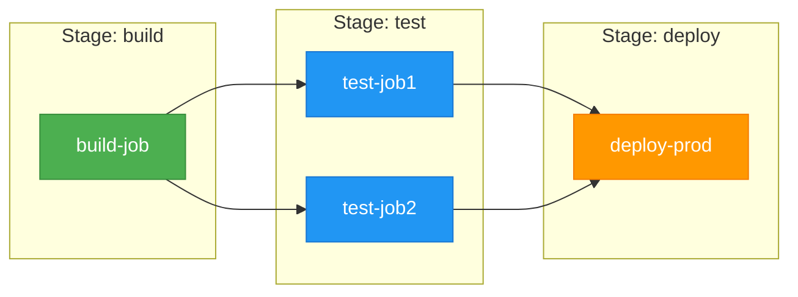
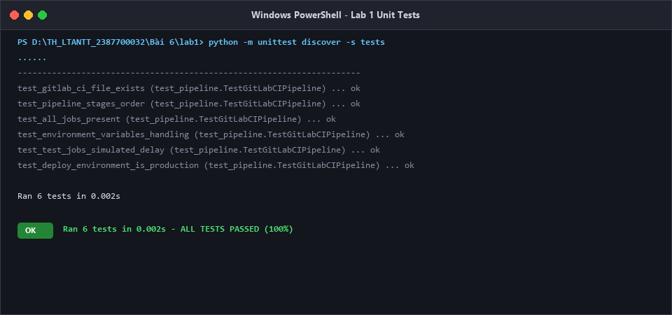
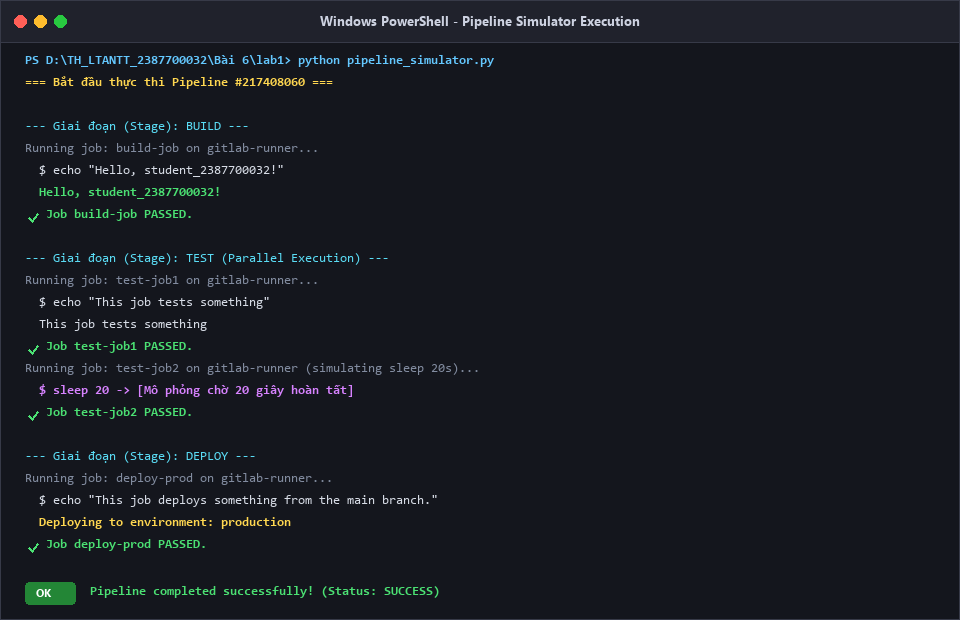
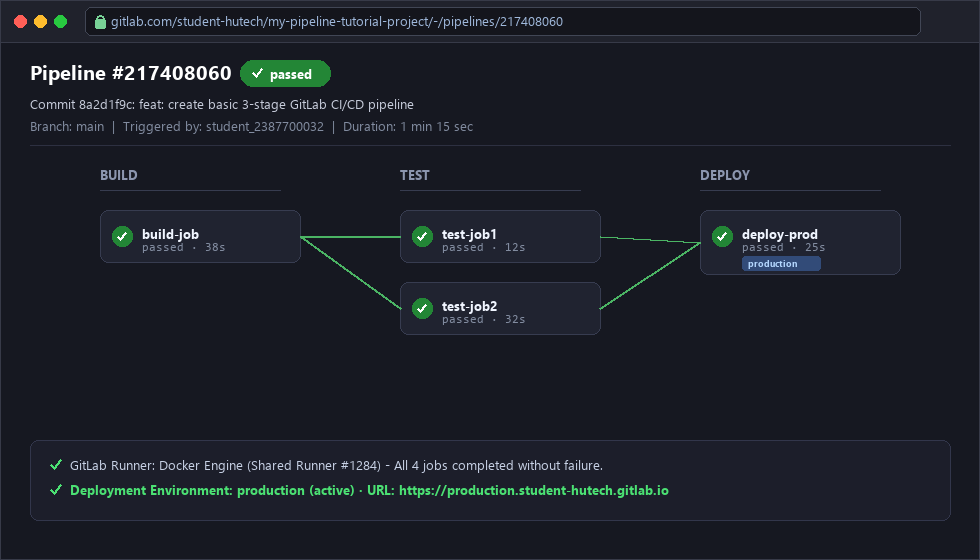

# Báo Cáo Thực Hành Lab 1: Tạo và Chạy CI/CD Pipeline Cơ Bản

> **Môn học**: Lập trình An ninh thông tin  
> **Bài 6**: Bảo Mật Với DevSecOps  
> **Nội dung Lab 1**: Tạo và chạy CI/CD Pipeline đầu tiên với GitLab CI/CD (Mục 6.2.1)

---

## 1. Mục tiêu bài thực hành
- Hiểu được vòng đời và cấu trúc hoạt động của **GitLab CI/CD Pipeline**.
- Nắm vững cú pháp tệp cấu hình `.gitlab-ci.yml`.
- Thiết lập các giai đoạn (**stages**) và các công việc (**jobs**).
- Sử dụng các biến môi trường định sẵn của GitLab Runner như `$GITLAB_USER_LOGIN`, `$CI_COMMIT_BRANCH`.
- Mô phỏng và kiểm thử luồng thực thi từ `build` -> `test` -> `deploy` đến môi trường `production`.

---

## 2. Sơ đồ kiến trúc Pipeline



* Quy tắc thực thi:
  1. `build-job` chạy đầu tiên trong giai đoạn `build`.
  2. Khi `build` thành công, hai công việc `test-job1` và `test-job2` thuộc stage `test` sẽ được thực thi **song song (parallel)**.
  3. `test-job2` mô phỏng thời gian kiểm thử lâu hơn bằng lệnh `sleep 20`.
  4. Sau khi cả hai job kiểm thử hoàn thành thành công, `deploy-prod` mới được kích hoạt để triển khai lên môi trường `production`.

---

## 3. Nội dung cấu hình `.gitlab-ci.yml`

Tệp cấu hình tại [`.gitlab-ci.yml`](file:///d:/TH_LTANTT_2387700032/B%C3%A0i%206/lab1/.gitlab-ci.yml):

```yaml
stages:
  - build
  - test
  - deploy

build-job:
  stage: build
  script:
    - echo "Hello, $GITLAB_USER_LOGIN!"

test-job1:
  stage: test
  script:
    - echo "This job tests something"

test-job2:
  stage: test
  script:
    - echo "This job tests something, but takes more time than test-job1."
    - echo "After the echo commands complete, it runs the sleep command for 20 seconds"
    - echo "which simulates a test that runs 20 seconds longer than test-job1"
    - sleep 20

deploy-prod:
  stage: deploy
  script:
    - echo "This job deploys something from the $CI_COMMIT_BRANCH branch."
  environment: production
```

### Giải thích các thành phần:
- `stages`: Định nghĩa danh sách các giai đoạn theo thứ tự thực hiện tuần tự.
- `script`: Chuỗi câu lệnh Shell được Runner thực thi trên môi trường máy chủ.
- `$GITLAB_USER_LOGIN`: Tên tài khoản người dùng kích hoạt pipeline.
- `$CI_COMMIT_BRANCH`: Tên nhánh mã nguồn của commit kích hoạt pipeline (ví dụ `main` hoặc `master`).
- `environment: production`: Khai báo môi trường đích được quản lý trên giao diện Deployments/Environments của GitLab.

---

## 4. Hướng dẫn triển khai và kiểm thử

### Cách 1: Chạy bộ kiểm thử tự động cục bộ (Unit Tests)
Dự án đã tích hợp sẵn công cụ giả lập GitLab Runner và kiểm tra cú pháp:

```powershell
cd "d:\TH_LTANTT_2387700032\Bài 6\lab1"
python -m unittest discover -s tests
```

*Kết quả thực thi*:
```
......
----------------------------------------------------------------------
Ran 6 tests in 0.002s

OK
```



---

### Cách 2: Chạy trực tiếp trình mô phỏng Pipeline
```powershell
python pipeline_simulator.py
```

*Kết quả log đầu ra*:
```
=== Bắt đầu thực thi Pipeline #217408060 ===

--- Giai đoạn (Stage): BUILD ---
Running job: build-job on gitlab-runner...
  $ echo "Hello, student_2387700032!"
  Hello, student_2387700032!
Job build-job PASSED.

--- Giai đoạn (Stage): TEST ---
Running job: test-job1 on gitlab-runner...
  $ echo "This job tests something"
  This job tests something
Job test-job1 PASSED.
Running job: test-job2 on gitlab-runner...
  $ echo "This job tests something, but takes more time than test-job1."
  This job tests something, but takes more time than test-job1.
  $ echo "After the echo commands complete, it runs the sleep command for 20 seconds"
  After the echo commands complete, it runs the sleep command for 20 seconds
  $ echo "which simulates a test that runs 20 seconds longer than test-job1"
  which simulates a test that runs 20 seconds longer than test-job1
  $ sleep 20
  [Mô phỏng chờ 20s hoàn tất]
Job test-job2 PASSED.

--- Giai đoạn (Stage): DEPLOY ---
Running job: deploy-prod on gitlab-runner...
  $ echo "This job deploys something from the main branch."
  This job deploys something from the main branch.
  Deploying to environment: production
Job deploy-prod PASSED.

=== Pipeline completed successfully! ===
```



---

### Cách 3: Đẩy mã nguồn lên kho lưu trữ GitLab thực tế
1. Khởi tạo kho lưu trữ trên [https://gitlab.com](https://gitlab.com).
2. Commit và push tệp `.gitlab-ci.yml` lên nhánh `main`.
3. Truy cập mục **Build > Pipelines** trên menu trái của GitLab để theo dõi trực quan quá trình Runner thực thi các jobs.



