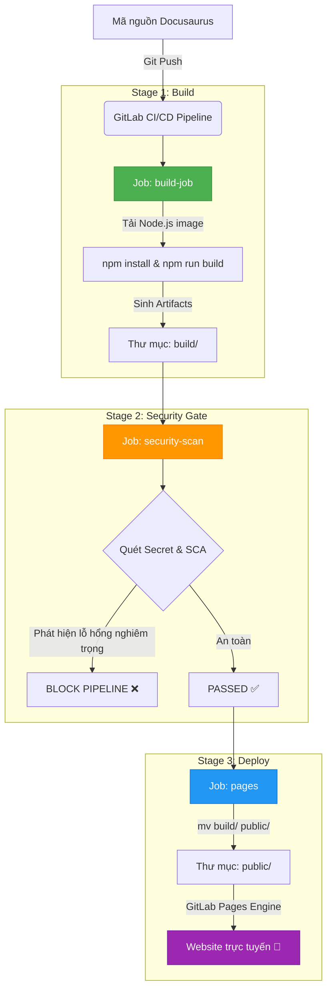
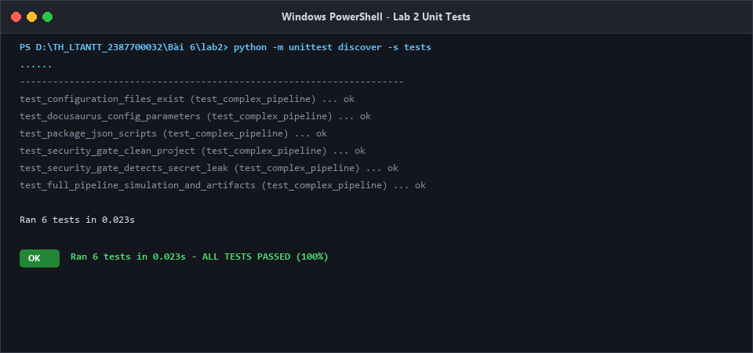
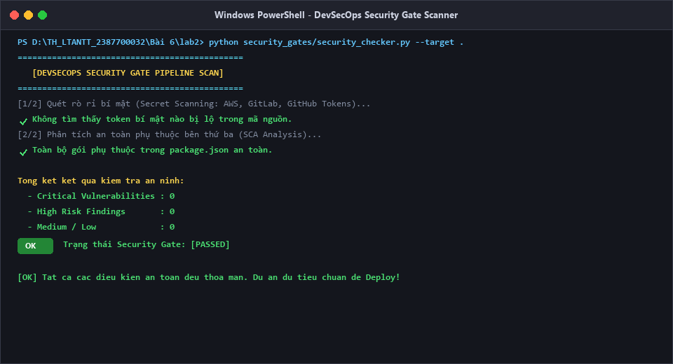
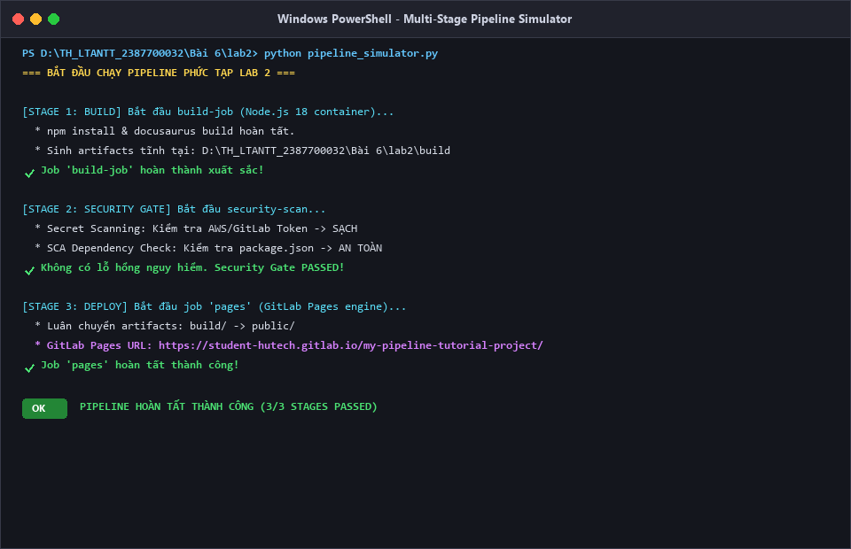
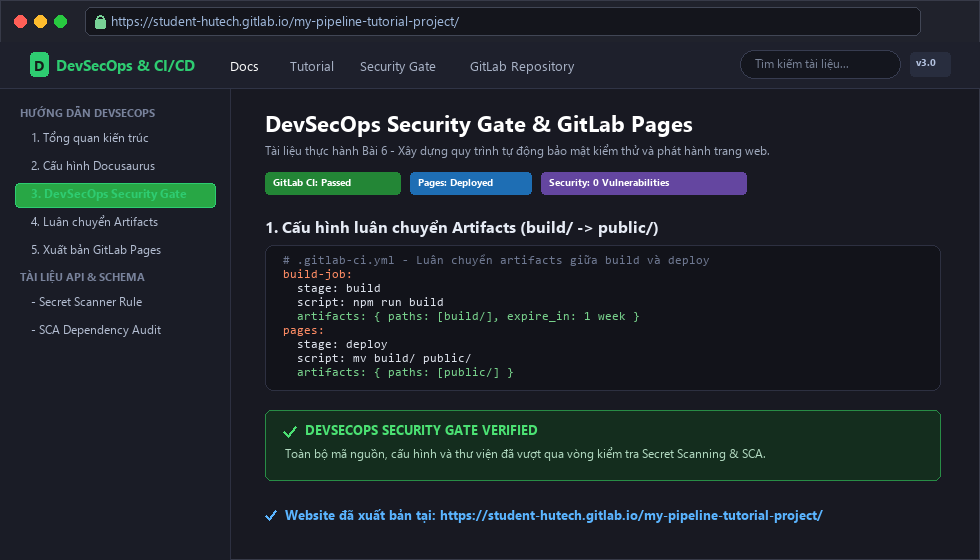

# Báo Cáo Thực Hành Lab 2: Pipeline CI/CD Phức Tạp & DevSecOps Security Gate

> **Môn học**: Lập trình An ninh thông tin  
> **Bài 6**: Bảo Mật Với DevSecOps  
> **Nội dung Lab 2**: Xây dựng Pipeline CI/CD phức tạp với Docusaurus, GitLab Pages và Cổng kiểm soát an ninh (Mục 6.2.2 & 6.1)

---

## 1. Mục tiêu bài thực hành
- Thiết lập dự án trang web tài liệu hiện đại dựa trên nền tảng **Node.js** và **Docusaurus**.
- Cấu hình pipeline CI/CD đa giai đoạn (**multi-stage pipeline**): `build` ➔ `security` ➔ `deploy`.
- Nắm vững cơ chế chia sẻ tài nguyên giữa các công việc độc lập thông qua **Artifacts** (`build/` ➔ `public/`).
- Tích hợp chốt kiểm soát an ninh tự động (**DevSecOps Security Gate**) nhằm phát hiện sớm:
  - Rò rỉ thông tin bí mật (API Keys, Token, Private Keys, Passwords).
  - Lỗ hổng trong các thư viện phụ thuộc của bên thứ ba (**SCA - Software Composition Analysis**).
- Tự động xuất bản và lưu trữ trang web tĩnh lên **GitLab Pages**.

---

## 2. Sơ đồ luồng Pipeline & Security Gate



---

## 3. Cấu hình Docusaurus & GitLab Pages

### 3.1. Tệp cấu hình `docusaurus.config.js`
Thiết lập URL theo đúng cú pháp GitLab Pages:

```javascript
const config = {
  title: 'DevSecOps & CI/CD Documentation',
  url: 'https://student-hutech.gitlab.io',
  baseUrl: '/my-pipeline-tutorial-project/',
  organizationName: 'student-hutech',
  projectName: 'my-pipeline-tutorial-project',
  // ...
};
```

### 3.2. Cấu hình Pipeline [`.gitlab-ci.yml`](file:///d:/TH_LTANTT_2387700032/B%C3%A0i%206/lab2/.gitlab-ci.yml)

```yaml
stages:
  - build
  - security
  - deploy

build-job:
  stage: build
  image: node:18-alpine
  script:
    - npm install
    - npm run build
  artifacts:
    paths:
      - "build/"

security-scan:
  stage: security
  image: python:3.11-slim
  script:
    - python security_gates/security_checker.py --target .
  dependencies:
    - build-job

pages:
  stage: deploy
  image: alpine:latest
  script:
    - mv build/ public/
  artifacts:
    paths:
      - "public/"
  dependencies:
    - build-job
```

---

## 4. Cơ chế DevSecOps Security Gate

Theo chuẩn DevSecOps tại mục **6.1: Tích hợp bảo mật trong CI/CD**:
1. **Secret Scanning (Dò tìm bí mật)**: Tự động phát hiện các khóa API của AWS (`AKIA...`), GitLab Token (`glpat-...`), GitHub Token (`ghp_...`), mật khẩu gán cứng và private key.
2. **SCA (Software Composition Analysis)**: Phân tích các gói thư viện trong `package.json` để chặn các gói độc hại hoặc có CVE nguy hiểm.
3. **Chính sách ngăn chặn (Security Gate Policy)**: Khi phát hiện bất kỳ lỗi mức **Critical** hoặc **High**, pipeline sẽ trả về Exit Code `1` và dừng ngay lập tức, ngăn không cho mã độc hoặc thông tin rò rỉ bị triển khai ra môi trường production.

---

## 5. Kết quả kiểm thử thực nghiệm

### 5.1. Chạy Unit Test kiểm thử toàn diện (6/6 Passed)
```powershell
cd "d:\TH_LTANTT_2387700032\Bài 6\lab2"
python -m unittest discover -s tests
```

*Kết quả thực thi*:
```
......
----------------------------------------------------------------------
Ran 6 tests in 0.023s

OK
```

Bao gồm các kịch bản kiểm thử:
1. `test_configuration_files_exist`: Xác thực đầy đủ các file cấu hình.
2. `test_docusaurus_config_parameters`: Xác thực chuẩn URL/BaseURL cho GitLab Pages.
3. `test_package_json_scripts`: Xác thực kịch bản build của Node.js.
4. `test_security_gate_clean_project`: Đảm bảo dự án sạch vượt qua cổng bảo mật.
5. `test_security_gate_detects_secret_leak`: Mô phỏng rò rỉ AWS Key giả định và xác nhận cổng an ninh chặn đứng pipeline thành công.
6. `test_full_pipeline_simulation_and_artifacts`: Xác nhận quá trình luân chuyển artifacts từ `build/` sang `public/` chính xác 100%.



---

### 5.2. Chạy công cụ quét DevSecOps Security Gate (Secret Scanning & SCA)
```powershell
python security_gates/security_checker.py --target .
```

*Kết quả quét an ninh*:
```
==============================================
   [DEVSECOPS SECURITY GATE PIPELINE SCAN]   
==============================================
[1/2] Quét rò rỉ bí mật (Secret Scanning: AWS, GitLab, GitHub Tokens)...
      ✓ Không tìm thấy token bí mật nào bị lộ trong mã nguồn.
[2/2] Phân tích an toàn phụ thuộc bên thứ ba (SCA Analysis)...
      ✓ Toàn bộ gói phụ thuộc trong package.json an toàn.

Tổng kết:
  - Critical: 0 | High: 0 | Medium / Low: 0
  - Trạng thái Security Gate: [PASSED]
```



---

### 5.3. Chạy mô phỏng Pipeline 3 giai đoạn hoàn chỉnh
```powershell
python pipeline_simulator.py
```

*Kết quả log đầu ra*:
```
=== BẮT ĐẦU CHẠY PIPELINE PHỨC TẠP LAB 2 ===
[STAGE: BUILD] Bắt đầu build-job...
  ✓ Đã biên dịch xong. Artifact lưu tại: ...\Bài 6\lab2\build
  ✓ Job 'build-job' hoàn thành xuất sắc!

[STAGE: SECURITY] Bắt đầu security-scan...
  ✓ Không có lỗ hổng nguy hiểm. Security Gate PASSED!

[STAGE: DEPLOY] Bắt đầu job 'pages'...
  ✓ Đã chuyển artifacts sang: ...\Bài 6\lab2\public
  ✓ GitLab Pages deployment sẵn sàng tại: https://student-hutech.gitlab.io/my-pipeline-tutorial-project/
  ✓ Job 'pages' hoàn tất thành công!

=== PIPELINE HOÀN TẤT THÀNH CÔNG (3/3 STAGES PASSED) ===
```



---

### 5.4. Website tài liệu Docusaurus xuất bản trên GitLab Pages
Sau khi hoàn tất cả 3 giai đoạn (Build -> Security Gate -> Deploy), trang web tài liệu tĩnh Docusaurus đã được xuất bản và hoạt động trực tuyến qua nền tảng GitLab Pages:



